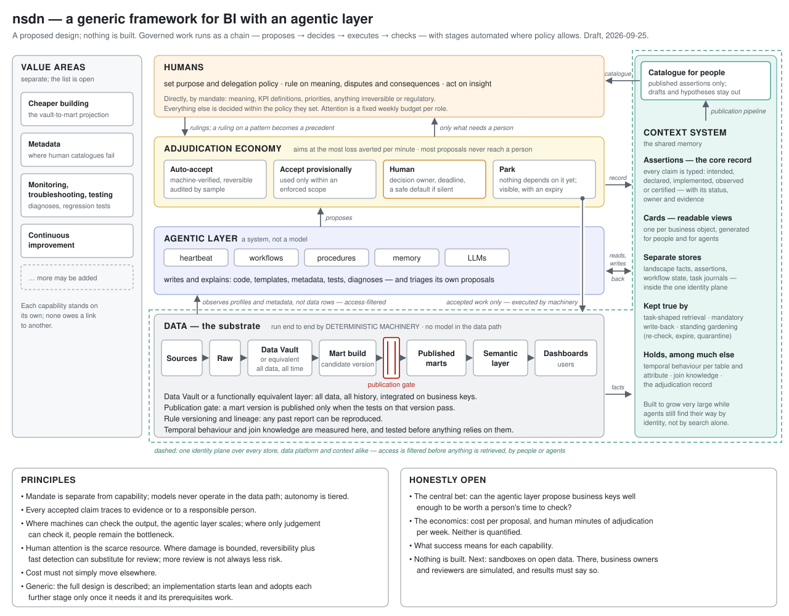

# 080 — Overview for discussion: main points and a schematic

**Status: working draft, 2026-09-24.** The main points of the project for discussing it with
other people, and a first sketch of the schematic that shows them. Stored at the author's
request, verbatim from the conversation in which it was drafted. The SVG is not yet drawn.

*Updated 2026-09-25, session 05.* The main points were brought up to date with what was decided
since — the context system ([120](../10_architecture/120_context-layer.md),
[ADR-0011](../20_decisions/0011-assertions-identity-plane-publication-gate.md)), the adjudication
economy ([155](../10_architecture/155_adjudication-economy.md)) and the generic, lean-start framework
([ADR-0012](../20_decisions/0012-generic-framework-lean-start.md)) — and the SVG is drawn. Both are in
the section [Updated main points and the schematic](#updated-main-points-and-the-schematic) at the
end. The text between here and that section is the 2026-09-24 draft, kept as it was; where they
differ, the update is current.

---

**On the schematic.** Here are the points I'd put in front of other people. They cover the whole project, not just the task table.

1. **The premise.** LLMs lower the cost of building and maintaining a data landscape so much that what humans contribute in BI changes. Plenty of designs that were too laborious for ordinary teams become affordable.
2. **Three faculties, working on one substrate.** Data is what gets worked on. The three that do the work are deterministic machinery, the agentic layer and humans.
3. **Mandate is separate from capability.** Each faculty has a mandate, meaning what it is *allowed* to do. Models never touch the data path. The agentic layer proposes; humans rule on meaning and set purpose.
4. **The agentic layer is a system, not a model.** It is a heartbeat, workflows, documented procedures, memory and LLMs.
5. **Work is allocated by strength, as a chain.** Every task runs proposes → decides → executes → checks.
   - Machinery runs everything that touches data.
   - The agentic layer writes and explains: code, templates, metadata, tests, diagnoses.
   - Humans decide meaning, disputes, consequences and commitment.
6. **The reference architecture is familiar.**
   - Sources → raw.
   - Data Vault, for all the data, all the time.
   - Dimensional marts and a semantic layer, human-readable and for self-service.
   - Rule versioning, so any past report can be reproduced.
7. **The value areas are separate, and the list is open.**
   - Cheaper building (the vault-to-mart projection).
   - Metadata, where human-made catalogues fail today.
   - Monitoring, troubleshooting and testing.
   - Continuous improvement.
8. **Safeguards.**
   - Every accepted claim traces to evidence or to a responsible person.
   - Where machines can check the output, the agentic layer scales. Where only judgement can check it, humans stay the bottleneck.
   - Cost must not simply move elsewhere.
9. **Honestly open.**
   - The central bet: can the agentic layer propose business keys well enough to be worth checking?
   - The economics aren't quantified.
   - Nothing is built yet. A proof of concept on public data comes next.

**How I'd draw it.** I'd use a layered architecture picture, because BI people read a left-to-right data flow instantly. The new part is overlaying *who does what* on top of it.

```
┌──────────────────────── HUMANS ─────────────────────────┐
│ set purpose · decide meaning · approve · act on insight │
└────────▲ asks, reports ─────────────────── decides ▼────┘
┌───────────────────── AGENTIC LAYER ─────────────────────┐
│ heartbeat │ workflows │ procedures │ memory │ LLMs      │
│ writes templates & rules · metadata · tests · diagnoses │
└────────▲ observes ──────────────────── proposes ▼───────┘
┌─────────────── DATA (substrate) · run by DETERMINISTIC MACHINERY ───────────────┐
│ sources → raw → DATA VAULT → MARTS → SEMANTIC LAYER → dashboards / users        │
│             (all data,        (human-readable,                                  │
│              all time)         self-service)       + rule versioning, lineage   │
└─────────────────────────────────────────────────────────────────────────────────┘
 side panel: value areas        footer: principles (mandate, no models in data path,
                                traceability) · open questions (central bet, economics)
```

The three bands stack the faculties by mandate: machinery at the bottom running the pipeline, the agentic layer in the middle, humans on top. The arrows show the chain: the agentic layer observes and proposes, humans decide, machinery executes. The side panel holds the value areas and the footer holds the principles and open questions, so one picture covers all nine points.

---

## Updated main points and the schematic

*2026-09-25, session 05.* Drafted in the conversation and accepted by the author, verbatim:

> This is a really good schematic, perfectly readible to me (the main audience). 7 and 8 are
> definitely separate, they are load-bearing. Adjudication economy location is good. It's dense, but
> it's readable to me. Do as you proposed.

*Revised the same day after external review — gpt-5.6-sol on the points, GPT-6 Astra on the
schematic — recorded in
[XREV_2026-09-25_overview-points_sol](../30_research/notes/XREV_2026-09-25_overview-points_sol.md) and
[XREV_2026-09-25_overview-schematic_astra](../30_research/notes/XREV_2026-09-25_overview-schematic_astra.md).
The author accepted every finding except sol's sixth, and ruled on the first in
[ADR-0013](../20_decisions/0013-data-vault-or-equivalent.md). The version reviewed is at commit
`a930af0`.*

The points below supersede the nine above. Each is marked *unchanged*, *changed* or *new* against the
2026-09-24 draft. They describe a proposed design: nothing is built, and every point says what the
framework would do, not what has been shown.

1. **The premise** *(unchanged)*. LLMs would lower the cost of building and maintaining a data
   landscape so much that what humans contribute in BI changes.
2. **Three faculties, one substrate** *(unchanged)*. Data is what gets worked on; deterministic
   machinery, the agentic layer and humans would do the work.
3. **Mandate is separate from capability** *(changed)*. Models never touch the data path. The agentic
   layer proposes. Humans set purpose, set the policy for what may be delegated, and rule directly on
   meaning; everything else is decided within that policy.
4. **The agentic layer is a system, not a model** *(unchanged)*. It would be a heartbeat, workflows,
   procedures, memory and LLMs.
5. **Work is allocated by strength, as a chain** *(changed)*. Governed work would run proposes →
   decides → executes → checks, with stages automated where policy allows;
   [070](070_task-allocation.md) spells this out for 44 tasks.
6. **The reference architecture is familiar, plus a publication gate** *(changed)*. Sources → raw →
   Data Vault or a functionally equivalent layer — all data, all history, integrated on business keys
   ([ADR-0013](../20_decisions/0013-data-vault-or-equivalent.md)) → marts → semantic layer, with rule
   versioning. New: a mart version would be published only when the tests on that version pass; a
   failing test blocks it
   ([ADR-0011](../20_decisions/0011-assertions-identity-plane-publication-gate.md)).
7. **The context system is the shared memory** *(new)*. Every claim would be a typed assertion with a
   status, an owner and evidence; cards would be readable views of them; all stores would share one
   set of permanent identifiers, with access filtered before retrieval. The catalogue for people would
   be fed from it only through a publication pipeline, so that it is one investment rather than two
   ([120](../10_architecture/120_context-layer.md)). Load-bearing.
8. **The adjudication economy** *(new)*. Human attention would be a fixed weekly budget, and triage
   aims to spend it where review prevents the most damage per minute — a way of reasoning at first,
   and a number only once audit history exists. Four lanes — auto-accept, provisional, human, park;
   most proposals would never reach a person. The human lane gets an owner, a deadline, and a safe
   default if nobody answers, such as *stays provisional within its scope*; audits check that the
   lanes work ([155](../10_architecture/155_adjudication-economy.md)). Load-bearing.
9. **The value areas are separate, and the list is open** *(unchanged)*. Cheaper building (the
   vault-to-mart projection); metadata, where human-made catalogues fail today; monitoring,
   troubleshooting and testing; continuous improvement — and more may be added
   ([ADR-0009](../20_decisions/0009-separate-capabilities-open-value-areas.md)).
10. **Safeguards** *(changed)*. The three above stand, plus: more review is not automatically less
    risk — where the damage is bounded, reversibility plus fast detection can substitute for review.
11. **A generic framework that starts lean** *(new)*. The documents describe the full design; an
    implementation would start lean and adopt each further stage only once it needs it and the
    prerequisites have been shown to work
    ([ADR-0012](../20_decisions/0012-generic-framework-lean-start.md)).
12. **Honestly open** *(changed)*. The business-key bet (`EVI-OP-1`); the economics, now two numbers —
    cost per proposal and human minutes of adjudication per week (`CON-OP-2`); what success means per
    capability (`CON-OP-15`). Nothing is built. Next come sandboxes on open data, where business owners
    and reviewers are simulated, and results must say so.

### The schematic



[`080_overview-schematic.svg`](080_overview-schematic.svg) keeps the three bands of the sketch above
and adds: a band between humans and the agentic layer for the adjudication economy and its four
lanes, placed there because it is where proposals meet human attention, with accepted work routed
from it to execution; a context-system column on the right, connected to every band, with the
catalogue for people as a separate compartment fed only through the publication pipeline; a dashed
boundary for the one identity plane, spanning the data platform and the context stores; and the
publication gate between a mart's build and its published version. The value areas are on the left,
the principles and open questions in the footer. It is dense by choice: its main audience is the
author, who finds it readable. A stripped version for presenting could be drawn later if needed.
